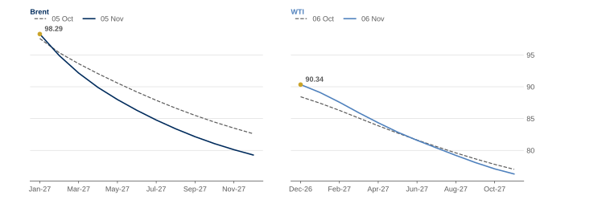
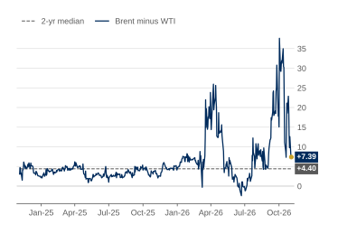
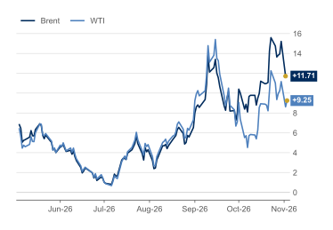
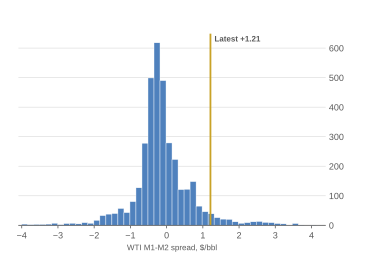
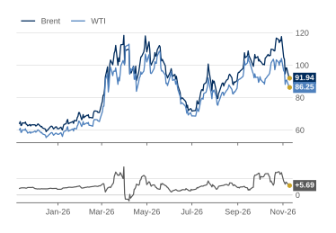

# Oil Curve Tracker

A Python tool that tracks the shape of the Brent and WTI crude oil futures curves, flags when each moves
between backwardation and contango, and follows the Brent-WTI spread.

**Data sources**
- [EIA Open Data API](https://www.eia.gov/opendata/): Brent and WTI spot prices, plus WTI futures history (to April 2024)
- Yahoo Finance (via `yfinance`): live Brent (NYMEX BZ) and WTI (NYMEX CL) futures contracts, M1 to M12

**Status:** working end to end. A GitHub Actions workflow runs the tracker every weekday at 22:30 UK time
and commits the day's curves, charts and the table below.

**Web report:** https://tbysmll.github.io/oil-curve-tracker/ (today's numbers, charts and my commentary on one page)

## Latest numbers (updated automatically)

<!-- LATEST-NUMBERS:START -->

Run at 06 Nov 2026 02:41 UK time. Prices in $/bbl. Every row shows the date its prices come from.

### Today's numbers

| Measure | Value | Reading | Data date | Working |
|---|---:|---|---|---|
| Brent M1-M2 | +3.84 | backwardation | 05 Nov 2026 | 2027-01 minus 2027-02 |
| Brent M1-M6 | +12.95 | backwardation | 05 Nov 2026 | 2027-01 minus 2027-06 |
| Brent M1-M12 | +20.71 | backwardation | 05 Nov 2026 | 2027-01 minus 2027-12 |
| WTI M1-M2 | +1.42 | backwardation | 05 Nov 2026 | 2026-12 minus 2027-01 |
| WTI M1-M6 | +8.80 | backwardation | 05 Nov 2026 | 2026-12 minus 2027-05 |
| WTI M1-M12 | +16.52 | backwardation | 05 Nov 2026 | 2026-12 minus 2027-11 |
| Brent-WTI spot spread (EIA) | +7.39 | location spread | 03 Nov 2026 | Brent 107.03 minus WTI 99.64 |
| Dated Brent minus front-month future | +3.43 | spot above future | 03 Nov 2026 (latest date both sources have) | EIA 107.03 minus Yahoo BZ=F 103.60 |
| Dated Brent minus front-month future, 2-year average | +2.94 | today +3.43 vs 2-year average +2.94 | 04 Nov 2024 to 03 Nov 2026 | mean of 495 trading days with both EIA and Yahoo prices |
| WTI M1-M2 percentile vs EIA history | 96.1% | higher than 96.1% of trading days, 2010-24 | today 05 Nov 2026; history 04 Jan 2010 to 05 Apr 2024 | +1.42 is higher than 3,457 of 3,598 trading days |

### Charts

**Figure 1: Both curves in backwardation; Brent steeper at +20.71 $/bbl over 12 months**  
Futures price by delivery month, $/bbl: latest (solid) vs the same contracts one month earlier (dashed)

*Source: NYMEX via Yahoo Finance. Data as of 05 Nov 2026 (Brent), 05 Nov 2026 (WTI).*

**Figure 2: Brent-WTI spot spread down 30.23 $/bbl over the past month, to +7.39**  
Daily Brent (Dated, FOB) minus WTI (Cushing) spot price, $/bbl

*Source: EIA. Data as of 03 Nov 2026.*

**Figure 3: Six-month spreads both up on the month: Brent +12.95, WTI +8.80 $/bbl**  
Daily spread between today's M1 and M6 contracts, held fixed (Brent Jan-27 minus Jun-27; WTI Dec-26 minus May-27), $/bbl

*Source: NYMEX via Yahoo Finance. Data as of 05 Nov 2026 (Brent), 05 Nov 2026 (WTI).*

**Figure 4: WTI M1-M2 at +1.42 $/bbl: higher than 96.1% of trading days, 2010-24**  
Number of days at each WTI M1-M2 spread, Jan-10 to Apr-24 (3,598 days); gold line = latest value

*Note: 18 days below -4.00 $/bbl not shown (lowest -58.06 on 20 Apr 2020).*  
*Source: EIA (history to 05 Apr 2024), NYMEX via Yahoo Finance (latest, 05 Nov 2026).*

**Figure 5: Brent-WTI front-month spread up over the year, to +8.24 $/bbl from +3.92**  
Continuous front-month futures, $/bbl (top); Brent minus WTI, $/bbl (bottom)

*Note: Continuous front-month series switch to the next contract on roll days, so a sudden jump on those days isn't a real price move.*  
*Source: NYMEX via Yahoo Finance (BZ=F, CL=F). Data as of 05 Nov 2026.*

### Notes

- Brent and WTI curves can come from different days: each uses its latest day with all 12 contracts priced.
- Futures prices are settlements only: a run before 22:00 UK time uses the previous trading day's settlement.
- EIA spot prices run a few days behind; the WTI percentile deliberately compares today with 2010-2024.

<!-- LATEST-NUMBERS:END -->

## Setup
1. Install Python 3.10+.
2. In this folder: `python -m venv .venv`, then activate it
   (Windows: `.venv\Scripts\activate`, Mac: `source .venv/bin/activate`).
3. `pip install -r requirements.txt`
4. Copy `.env.example` to `.env` and add your free EIA API key.

## Files
| File | What it does |
|---|---|
| `config.py` | All settings in one place |
| `eia.py` | Downloads EIA spot prices and WTI futures history |
| `futures.py` | Builds today's Brent and WTI curves; saves a daily snapshot to `data/` |
| `spreads.py` | Calculates time spreads, the Brent-WTI spread, Dated Brent vs futures and the WTI M1-M2 percentile |
| `charts.py` | Draws the five charts into `docs/charts/`, including Brent vs WTI front-month futures |
| `interactive.py` | Interactive (Plotly) versions of the charts for the web report: hover for values, drag to zoom |
| `chart_style.py` | The house style shared by every chart and the web report: palette, font, layout, labels |
| `report.py` | Builds the numbers table, the Markdown summary and the web report `docs/index.html` |
| `main.py` | Runs everything: snapshot, charts, `output/summary.md`, the web report and this README's latest numbers |
| `commentary.txt` | My own commentary, shown on the web report |
| `.github/workflows/daily-update.yml` | Runs `main.py` every weekday at 22:30 UK time and commits the results |
| `CLAUDE.md` | Instructions Claude Code follows when working on this project |
| `LEARNING_GUIDE.md` | Step-by-step guide to building the rest with Claude Code |
