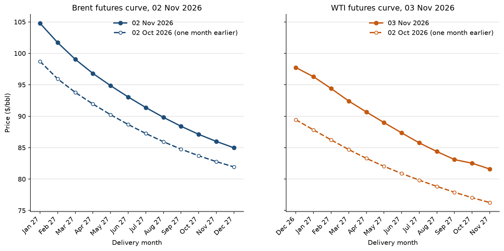
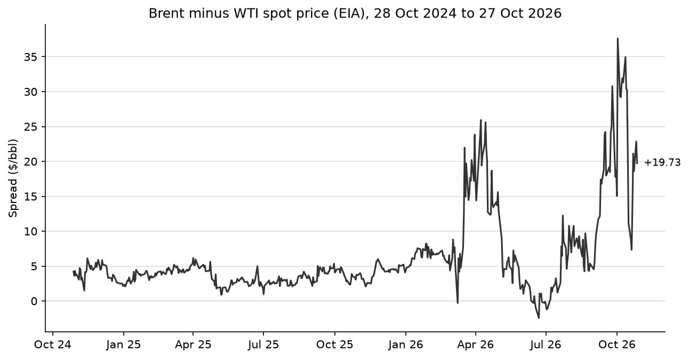
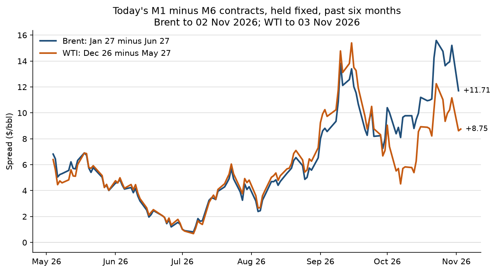
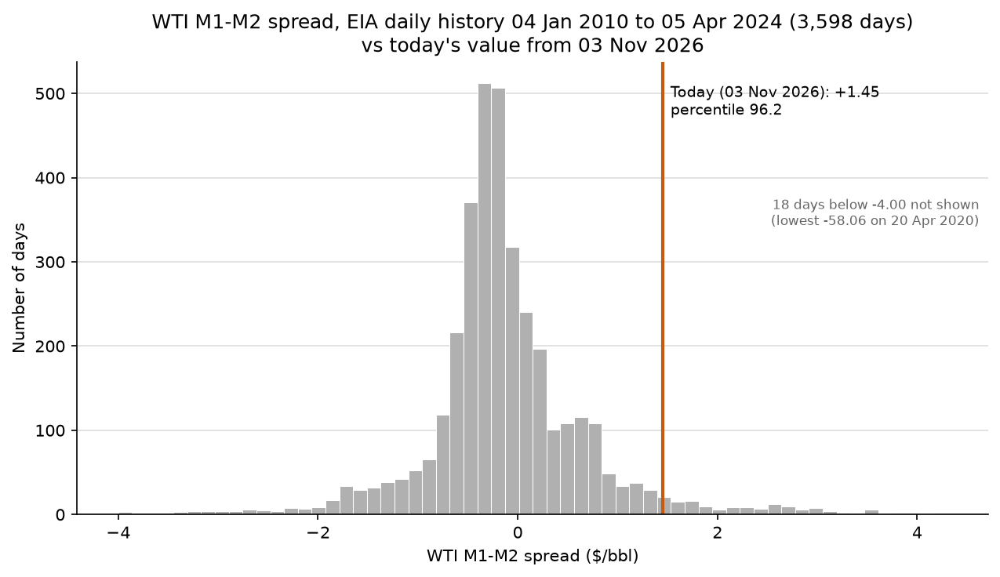

# Oil Curve Tracker summary

Run at 03 Nov 2026 10:45 UK time. Prices in $/bbl. Every row shows the date its prices come from.

### Today's numbers

| Measure | Value | Reading | Data date | Working |
|---|---:|---|---|---|
| Brent M1-M2 | +3.07 | backwardation | 02 Nov 2026 | 2027-01 minus 2027-02 |
| Brent M1-M6 | +11.71 | backwardation | 02 Nov 2026 | 2027-01 minus 2027-06 |
| Brent M1-M12 | +19.79 | backwardation | 02 Nov 2026 | 2027-01 minus 2027-12 |
| WTI M1-M2 | +1.45 | backwardation | 03 Nov 2026 | 2026-12 minus 2027-01 |
| WTI M1-M6 | +8.75 | backwardation | 03 Nov 2026 | 2026-12 minus 2027-05 |
| WTI M1-M12 | +16.13 | backwardation | 03 Nov 2026 | 2026-12 minus 2027-11 |
| Brent-WTI spot spread (EIA) | +19.73 | location spread | 27 Oct 2026 | Brent 123.10 minus WTI 103.37 |
| Dated Brent minus front-month future | +9.22 | spot above future | 27 Oct 2026 (latest date both sources have) | EIA 123.10 minus Yahoo BZ=F 113.88 |
| WTI M1-M2 percentile vs EIA history | 96.2 | percentile (not $/bbl) | today 03 Nov 2026; history 04 Jan 2010 to 05 Apr 2024 | 3,462 of 3,598 days at or below +1.45 |

### Charts

### Notes

- Brent and WTI curves can come from different days: each uses its latest day with all 12 contracts priced.
- If the tracker ran during US trading hours, the latest futures prices are live rather than closing prices.
- EIA spot prices run a few days behind; the WTI percentile deliberately compares today with 2010-2024.
