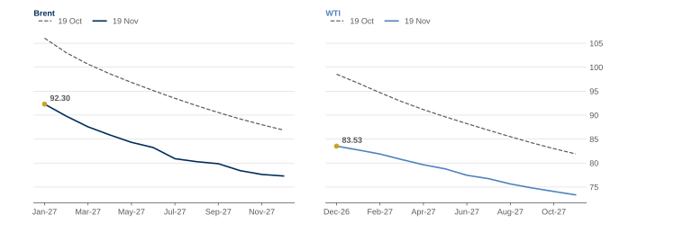
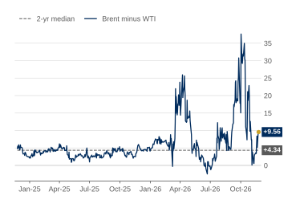
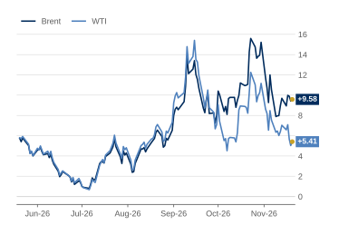
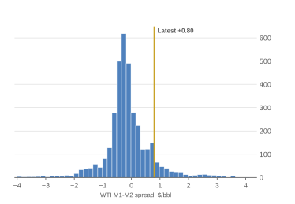
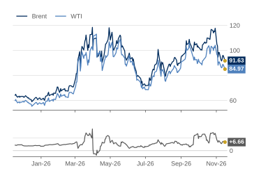

# Oil Curve Tracker summary

Run at 24 Nov 2026 06:13 UK time. Prices in $/bbl. Every row shows the date its prices come from.

### Today's numbers

| Measure | Value | Reading | Data date | Working |
|---|---:|---|---|---|
| Brent M1-M2 | +2.69 | backwardation | 23 Nov 2026 | 2027-01 minus 2027-02 |
| Brent M1-M6 | +9.17 | backwardation | 23 Nov 2026 | 2027-01 minus 2027-06 |
| Brent M1-M12 | +14.24 | backwardation | 23 Nov 2026 | 2027-01 minus 2027-12 |
| WTI M1-M2 | +1.10 | backwardation | 23 Nov 2026 | 2027-01 minus 2027-02 |
| WTI M1-M6 | +5.30 | backwardation | 23 Nov 2026 | 2027-01 minus 2027-06 |
| WTI M1-M12 | +9.70 | backwardation | 23 Nov 2026 | 2027-01 minus 2027-12 |
| Brent-WTI spot spread (EIA) | +3.41 | location spread | 17 Nov 2026 | Brent 92.94 minus WTI 89.53 |
| Dated Brent minus front-month future | -0.20 | spot below future | 17 Nov 2026 (latest date both sources have) | EIA 92.94 minus Yahoo BZ=F 93.14 |
| Dated Brent minus front-month future, 2-year average | +2.91 | today -0.20 vs 2-year average +2.91 | 18 Nov 2024 to 17 Nov 2026 | mean of 495 trading days with both EIA and Yahoo prices |
| WTI M1-M2 percentile vs EIA history | 94.1% | higher than 94.1% of trading days, 2010-24 | today 23 Nov 2026; history 04 Jan 2010 to 05 Apr 2024 | +1.10 is higher than 3,385 of 3,598 trading days |

### Charts

**Figure 1: Both curves in backwardation; Brent steeper at +14.24 $/bbl over 12 months**  
Futures price by delivery month, $/bbl: latest (solid) vs the same contracts one month earlier (dashed)

*Source: NYMEX via Yahoo Finance. Data as of 23 Nov 2026 (Brent), 23 Nov 2026 (WTI).*

**Figure 2: Brent-WTI spot spread down 7.71 $/bbl over the past month, to +3.41**  
Daily Brent (Dated, FOB) minus WTI (Cushing) spot price, $/bbl

*Source: EIA. Data as of 17 Nov 2026.*

**Figure 3: Six-month spreads both down on the month: Brent +9.17, WTI +5.30 $/bbl**  
Daily spread between today's M1 and M6 contracts, held fixed (Brent Jan-27 minus Jun-27; WTI Jan-27 minus Jun-27), $/bbl

*Source: NYMEX via Yahoo Finance. Data as of 23 Nov 2026 (Brent), 23 Nov 2026 (WTI).*

**Figure 4: WTI M1-M2 at +1.10 $/bbl: higher than 94.1% of trading days, 2010-24**  
Number of days at each WTI M1-M2 spread, Jan-10 to Apr-24 (3,598 days); gold line = latest value

*Note: 18 days below -4.00 $/bbl not shown (lowest -58.06 on 20 Apr 2020).*  
*Source: EIA (history to 05 Apr 2024), NYMEX via Yahoo Finance (latest, 23 Nov 2026).*

**Figure 5: Brent-WTI front-month spread up over the year, to +9.20 $/bbl from +4.53**  
Continuous front-month futures, $/bbl (top); Brent minus WTI, $/bbl (bottom)

*Note: Continuous front-month series switch to the next contract on roll days, so a sudden jump on those days isn't a real price move.*  
*Source: NYMEX via Yahoo Finance (BZ=F, CL=F). Data as of 23 Nov 2026.*

### Notes

- Brent and WTI curves can come from different days: each uses its latest day with all 12 contracts priced.
- Futures prices are settlements only: a run before 22:00 UK time uses the previous trading day's settlement.
- EIA spot prices run a few days behind; the WTI percentile deliberately compares today with 2010-2024.
