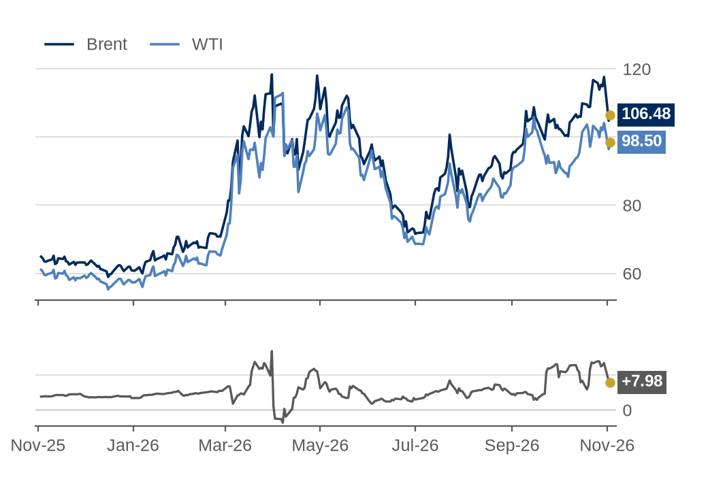

# Oil Curve Tracker summary

Run at 03 Nov 2026 12:01 UK time. Prices in $/bbl. Every row shows the date its prices come from.

### Today's numbers

| Measure | Value | Reading | Data date | Working |
|---|---:|---|---|---|
| Brent M1-M2 | +3.07 | backwardation | 02 Nov 2026 | 2027-01 minus 2027-02 |
| Brent M1-M6 | +11.71 | backwardation | 02 Nov 2026 | 2027-01 minus 2027-06 |
| Brent M1-M12 | +19.79 | backwardation | 02 Nov 2026 | 2027-01 minus 2027-12 |
| WTI M1-M2 | +1.61 | backwardation | 03 Nov 2026 | 2026-12 minus 2027-01 |
| WTI M1-M6 | +9.29 | backwardation | 03 Nov 2026 | 2026-12 minus 2027-05 |
| WTI M1-M12 | +17.49 | backwardation | 03 Nov 2026 | 2026-12 minus 2027-11 |
| Brent-WTI spot spread (EIA) | +19.73 | location spread | 27 Oct 2026 | Brent 123.10 minus WTI 103.37 |
| Dated Brent minus front-month future | +9.22 | spot above future | 27 Oct 2026 (latest date both sources have) | EIA 123.10 minus Yahoo BZ=F 113.88 |
| WTI M1-M2 percentile vs EIA history | 96.9 | percentile (not $/bbl) | today 03 Nov 2026; history 04 Jan 2010 to 05 Apr 2024 | 3,485 of 3,598 days at or below +1.61 |

### Charts

**Figure 1: Both curves in backwardation; Brent steeper at +19.79 $/bbl over 12 months**  
Futures price by delivery month, $/bbl: latest (solid) vs the same contracts one month earlier (dashed)

*Source: NYMEX via Yahoo Finance. Data as of 02 Nov 2026 (Brent), 03 Nov 2026 (WTI).*

**Figure 2: Brent-WTI spot spread down 11.05 $/bbl over the past month, to +19.73**  
Daily Brent (Dated, FOB) minus WTI (Cushing) spot price, $/bbl

*Source: EIA. Data as of 27 Oct 2026.*

**Figure 3: Six-month spreads both up on the month: Brent +11.71, WTI +9.29 $/bbl**  
Daily spread between today's M1 and M6 contracts, held fixed (Brent Jan-27 minus Jun-27; WTI Dec-26 minus May-27), $/bbl

*Source: NYMEX via Yahoo Finance. Data as of 02 Nov 2026 (Brent), 03 Nov 2026 (WTI).*

**Figure 4: WTI M1-M2 at +1.61 $/bbl: at or above 96.9% of days in 2010-24**  
Number of days at each WTI M1-M2 spread, Jan-10 to Apr-24 (3,598 days); gold line = latest value

*Note: 18 days below -4.00 $/bbl not shown (lowest -58.06 on 20 Apr 2020).*  
*Source: EIA (history to 05 Apr 2024), NYMEX via Yahoo Finance (latest, 03 Nov 2026).*

**Figure 5: Brent-WTI front-month spread up over the year, to +7.98 $/bbl from +3.84**  
Continuous front-month futures, $/bbl (top); Brent minus WTI, $/bbl (bottom)

*Note: Continuous front-month series switch to the next contract on roll days, so a sudden jump on those days isn't a real price move.*  
*Source: NYMEX via Yahoo Finance (BZ=F, CL=F). Data as of 03 Nov 2026.*

### Notes

- Brent and WTI curves can come from different days: each uses its latest day with all 12 contracts priced.
- If the tracker ran during US trading hours, the latest futures prices are live rather than closing prices.
- EIA spot prices run a few days behind; the WTI percentile deliberately compares today with 2010-2024.
